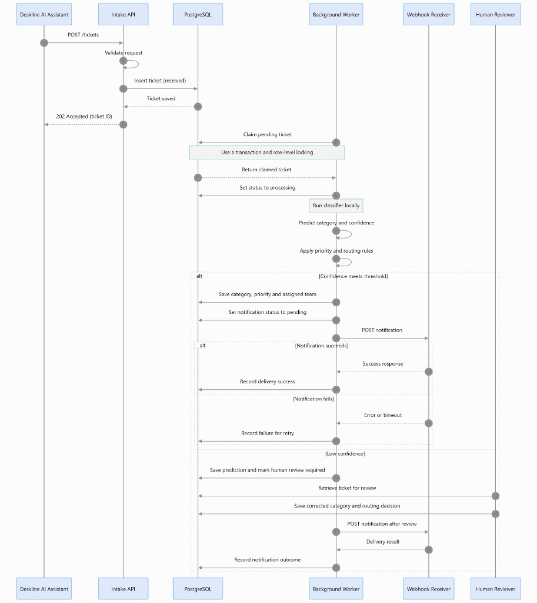

# Desktriage

## What I am building and why

### Problem Statement: Automated Classification and Prioritisation of Escalated Support Tickets

When an AI powered support assistant cannot resolve a user's query, the query may be escalated to a human support team as a ticket. These tickets can concern different topics and vary in the urgency with which they require attention.

Without a consistent triage process, support staff must manually interpret each ticket, determine its category and priority, and decide how it should be routed. This introduces additional workload and can lead to inconsistent prioritisation, incorrect routing, and delays in handling high priority requests.

The problem is to develop a service that automatically classifies escalated tickets by category, assesses their priority, and supports appropriate routing to the relevant support team. To avoid unreliable automated decisions, the service must also identify uncertain classifications and send them for human review rather than assigning them automatically.

The objective is to make ticket handling more consistent, efficient, and reliable while retaining human oversight where necessary.

### Defining the user needs

The requirements are derived from the needs of the people responsible for handling and managing escalated support tickets.

* Consistent categorisation: Support staff need to understand what each ticket concerns without having to interpret and categorise every query manually.
* Reliable prioritisation: Support staff need to identify which tickets require attention first, particularly when several tickets are awaiting resolution.
* Appropriate routing: Tickets need to reach the relevant team or queue to reduce unnecessary reassignment.
* Human oversight: Support staff need to review uncertain classifications rather than rely on potentially incorrect automated predictions.
* Traceability: Support staff need to understand how a ticket was categorised and prioritised so that decisions can be reviewed and corrected.
* Integration: Developers need to connect the triage service to an existing support assistant without coupling the classification logic to the assistant's internal implementation.

### Defining the functional requirements

Functional requirements describe what the service must do.

1. Ticket ingestion: Accept an escalated ticket through a defined interface.
2. Input validation: Validate incoming ticket data and reject malformed or incomplete requests appropriately.
3. Category classification: Assign a category to each valid ticket from a predefined set of categories.
4. Priority assessment: Determine the ticket's operational priority according to a defined classification or decision policy.
5. Confidence assessment: Determine whether the classification is sufficiently reliable for automated processing.
6. Human review: Send tickets with uncertain predictions to a human review queue.
7. Routing: Map validated category and priority results to the appropriate destination according to configurable routing rules.
8. Decision traceability: Record the predicted category, priority, confidence information, and routing outcome.
9. Error handling: Return meaningful errors for invalid inputs and handle processing failures without silently losing tickets.

### Defining the non functional requirements

Non-functional requirements describe the quality attributes and operational constraints of the service.

* Reliability: The service should process valid tickets consistently and avoid silently dropping requests.
* Performance: Classification should complete within a defined latency target suitable for the ticket-handling workflow.
* Maintainability: Classification logic, routing rules, and API concerns should be separated so that each can be modified and tested independently.
* Scalability: The service should be designed so that processing capacity can be increased as ticket volume grows.
* Security: Ticket data should be protected in transit and at rest where applicable, with appropriate authentication and access controls.
* Privacy: The service should process only the information needed for triage and avoid unnecessarily retaining sensitive information.
* Testability: Classification, prioritisation, routing, and uncertainty handling should be independently testable.
* Observability: Operational logs and metrics should make failures, processing delays, and routing outcomes measurable without unnecessarily exposing sensitive ticket content.

Specific targets for latency, availability, classification performance, and retention will be defined and justified during implementation.

### Defining the scope

Desktriage is intended to handle the triage stage after escalation, not the original conversation or final resolution of the user's issue.

### Defining the acceptance criteria

The following criteria describe how the service's behaviour and quality will be evaluated.

* A valid ticket can be submitted through the defined API and receives a structured response.
* Invalid ticket data is rejected with an appropriate error response.
* Valid tickets receive a category from the predefined category set.
* Valid tickets receive a priority according to the defined priority policy.
* Tickets below the configured confidence threshold are sent for human review rather than automatically routed.
* Tickets meeting the automatic routing criteria are assigned to the destination specified by the routing rules.
* Each triage decision can be traced through its recorded outcome.
* Automated tests cover successful classification, invalid inputs, routing decisions, and uncertain predictions.
* Evaluation results report category level precision, recall, and F1-score, alongside priority classification performance.
* Urgent ticket recall and the human review rate are measured on an appropriate evaluation dataset.
* API latency is measured against a documented performance target.

Classification thresholds and performance targets will be established using evaluation data rather than chosen solely to make the system appear successful.

## The dataset

Desktriage uses a labelled dataset of synthetic support tickets to develop and evaluate its classification and prioritisation pipeline. Details are in the [dataset card](dataset/desktriage_dataset_card.md). I used the priority definitions in the Cabinet Office [Technical incident management guidance](https://digital-handbook.cabinetoffice.gov.uk/docs/software/technical-incident-management-guidance.html).

Each record represents a query escalated by an AI-powered healthcare-policy assistant because it could not be resolved confidently or safely. The dataset contains fictional user queries covering supported healthcare-policy domains, different reasons for escalation, varying levels of operational priority, and examples requiring human review.

The dataset is designed to support supervised learning for ticket categorisation and experiments with priority assessment, confidence-based routing, and human escalation.

Each ticket is associated with a unique ticket_id and a pseudonymous user_id. These identifiers allow individual tickets to be tracked and multiple tickets from the same fictional user to be represented without including real personal identifiers.

The category and priority labels serve as ground-truth targets for training and evaluation. The dataset will also include ambiguous, out-of-scope, and insufficient-context examples to test the system's ability to avoid unreliable automatic decisions.

Because the dataset is synthetic, its results will not by themselves establish performance on real support tickets. The dataset, labelling rules, and evaluation methodology will be documented to make the limitations of the results explicit.

## The system architecture

The Deskline AI assistant submits an escalated ticket to the intake API. A background worker then classifies it, applies priority and routing rules, stores the result, and notifies a webhook. The assistant can read the ticket ID and status back from the API.


### Design rationale and trade-offs

- **Separate API and background worker:** The API can accept tickets without waiting for classification to finish. The worker processes tickets independently and can retry failed jobs. The trade-off is extra complexity in tracking ticket status and recovering interrupted jobs.
- **PostgreSQL database:** PostgreSQL allows the API and multiple workers to access shared ticket data. Row-level locking helps prevent workers from claiming the same ticket. The trade-off is additional setup and maintenance; if the database becomes unavailable, ticket processing and API operations that require it will be affected.
- **Classifier inside the worker:** Keeping the model inside the worker avoids an extra container and internal HTTP requests. The trade-off is that the model and worker must be deployed together, and scaling classification independently is harder.
- **Confidence-based human review:** Low-confidence predictions are sent for human review instead of being routed automatically. This reduces the risk of incorrect assignments but increases manual workload and can delay ticket handling.
- **Rule-based priority and routing:** Explicit rules make operational priorities and team assignments easier to understand and test. However, incomplete or outdated rules can produce incorrect decisions, and some tickets may not fit the defined categories.
- **Webhook notifications:** Notifications alert the destination system when a ticket is ready. If the receiver is unavailable or a request times out, delivery may fail. Retries can also produce duplicate notifications unless idempotency is implemented.
- **Docker Compose:** Containers provide a repeatable environment for running and testing the API, worker, database and notification receiver. The trade-off is additional configuration and resource usage compared with running everything in one process.
- **Persistent database storage:** A Docker volume keeps PostgreSQL data when its container is recreated. However, a volume alone does not protect against every disk failure or data loss, so backups and recovery procedures are still needed.

## How it works

Desktriage sequence diagram reflecting the PostgreSQL container, with the classifier running inside the background worker and the webhook receiver handling notifications.



Ticket field flow for the same path. It shows the values each step writes, from the queued row to the decision the status route returns.


## How to run it

### Get the project

Install [Docker Desktop](https://docs.docker.com/get-docker/) and [Git](https://git-scm.com/downloads). Docker Desktop includes Docker Compose. Start Docker Desktop and wait until it reports that the engine is running. The later Compose commands fail while Docker is stopped.

Clone the repository and move into it. The following commands expect this folder to be the current directory:

```bash
git clone https://github.com/ramy-glitch/Desktriage.git
cd Desktriage
```

Copy `.env.example` to `.env`. Compose reads that file for the database name, the ports, and `DATABASE_URL`. The example values are enough to run the stack on one machine.

```bash
cp .env.example .env
```

On PowerShell, the copy is `Copy-Item .env.example .env`.

### Database

PostgreSQL runs as the `db` service in `docker-compose.yml`. This step starts that service on its own. The intake API, the worker, and the webhook are the following sections.

Docker Desktop has to be running before Compose can start the container. From the repository root:

```bash
docker compose up db
```

Compose reads `.env`. `POSTGRES_USER`, `POSTGRES_PASSWORD`, and `POSTGRES_DB` are the role, password, and database name. `POSTGRES_PORT` is the port published on the host. Inside the container, PostgreSQL listens on port 5432. `DATABASE_URL` uses the host name `db` and port 5432, which is the address the API and worker use on the Compose network.

The first start of an empty `postgres_data` volume creates the database and runs `db/init/001_schema.sql`. The log reports `CREATE TABLE` for `tickets`, `triage_decisions`, and `webhook_deliveries`, then `database system is ready to accept connections`. A later start of the same volume opens the existing database and does not run that script again.

From a second terminal, list the tables. The user and database name are the `POSTGRES_USER` and `POSTGRES_DB` values from `.env`:

```bash
docker compose exec db psql -U desktriage -d desktriage -c "\dt"
```

`\d tickets`, `\d triage_decisions`, and `\d webhook_deliveries` show the columns of each table.

Editing `001_schema.sql` has no effect after the volume exists. A later change needs a new script or a migration. To apply this file again to a local database you are willing to discard:

```bash
docker compose down -v
docker compose up db
```

`docker compose down -v` deletes the `postgres_data` volume.

### Intake API

This starts the intake API and the database it depends on. Compose does not start the worker or the webhook.

```bash
docker compose up --build api
```

The image installs `common/requirements.txt` and `api/requirements.txt`, copies the shared library to `/app/desktriage_common` and the API to `/app/api`, sets `PYTHONPATH=/app`, and runs `python -m api.app.main`. Inside the container the process listens on port 8000. `API_PORT` in `.env` is the port published on the host. The default is 8000.

On startup the process reads settings and opens a database session. The log then shows `Application startup complete` and `Uvicorn running on http://0.0.0.0:8000`. `DATABASE_URL` has to use the same role password that was stored when the `postgres_data` volume was first created. `POSTGRES_PASSWORD` is applied only on that first start. A later change in `.env` leaves the old password in the volume. The API then logs `event=startup_failure` and exits. The database health check can still pass, because `pg_isready` does not use the password.

With the API up, check that this process is running and that PostgreSQL accepts a connection:

```bash
curl http://localhost:8000/health
```

A ready API returns `{"status":"ok","database":"ok"}`. In PowerShell, call `curl.exe`. `curl` there is `Invoke-WebRequest`.

Submit an escalated query. The body is the query, the escalation reason, and the user id. Category, priority, and assigned team are not intake fields.

```bash
curl.exe --% -X POST http://localhost:8000/tickets -H "Content-Type: application/json" -d "{\"query_text\":\"When does coverage start?\",\"escalation_reason\":\"assistant unsure\",\"user_id\":\"user-1\"}"
```

You might need to adjust this command to your OS (I used powershell windows), you cannot enter the request in the browser for this route because swagger is unable to map a function that was created outside of the routing function to the UI.

A valid ticket returns 202 with a new ticket id and the status `accepted`. That status is the intake acknowledgement. The stored row is `queued`, so a worker can claim it later. This response has no category and no team.

Read that ticket back. Replace the id with the one from the 202 response:

```bash
curl.exe http://localhost:8000/tickets/{ticket_id}
```

for example:

```bash
curl.exe http://localhost:8000/tickets/0901dfd7-e07c-4209-9525-8300af7c2b61
```

Before the worker has stored a decision, the body is the id, the status `queued`, and `"decision": null`. An unknown id returns 404.

The same row is visible in PostgreSQL:

```bash
docker compose exec db psql -U desktriage -d desktriage -c "SELECT ticket_id, status FROM tickets"
```

The user and database name are the `POSTGRES_USER` and `POSTGRES_DB` values from `.env`.

### Run Uvicorn without building the image

The API imports `desktriage_common` and `api` as top-level packages. In the image, both directories sit directly under `/app`, and `PYTHONPATH=/app` makes those imports resolve. In the repository, `desktriage_common` is inside `common/`. A process started from the repository root can import `api` and cannot import `desktriage_common` until `common` is on `PYTHONPATH`.

From the repository root in PowerShell, with the database container already running:

```powershell
$env:PYTHONPATH = "$pwd;$pwd\common"
$env:DATABASE_URL = "postgresql+psycopg://desktriage:<password>@127.0.0.1:5432/desktriage"
python -m uvicorn api.app.main:app --host 127.0.0.1 --port 8000
```

When running this command make sure to replace `<password>` with the value of `POSTGRES_PASSWORD`. Make sure you stop the api container: 

```powershell
docker compose stop api
```

and if you want to build the api image again use another terminal.

`$pwd` is the repository root. `$pwd\common` is the directory that contains `desktriage_common`. The user, password, database name, and port are `POSTGRES_USER`, `POSTGRES_PASSWORD`, `POSTGRES_DB`, and `POSTGRES_PORT` from `.env`. The host in this shell is `127.0.0.1`, because `db` is the Compose service name and resolves only on the Compose network. Leave `DATABASE_URL` in `.env` pointing at `db`. The shell variable applies to this process only, so the container can keep using `db`.

Uvicorn then serves the same routes. Startup still opens a database session, so an insert or a status read reaches PostgreSQL. If the API container is already bound to port 8000, choose another port for this process.

### Worker and webhook

This builds the worker and the webhook and starts them with the database. The worker waits until PostgreSQL is healthy and the webhook process has started. Compose does not start the intake API.

```bash
docker compose up --build worker
```

The webhook image installs `common/requirements.txt` and `webhook/requirements.txt`, copies the shared library to `/app/desktriage_common` and the receiver to `/app/webhook`, sets `PYTHONPATH=/app`, and runs `python -m webhook.app.main`. Inside the container it listens on port 8001. `WEBHOOK_PORT` in `.env` is the port published on the host. The default is 8001. The log shows `Uvicorn running on http://0.0.0.0:8001`.

The worker image installs `common/requirements.txt` and `worker/requirements.txt`, copies the shared library, the worker, and `models/` into the image, sets `PYTHONPATH=/app`, and runs `python -m worker.app.main`. Inference uses the copy of `models/classifier.keras` inside the image. `./config` is mounted at `/app/config`, so a threshold or routing change applies when the worker container starts again. A new model file is picked up only when the worker image is built again.

`DATABASE_URL` and `WEBHOOK_URL` come from `.env`. On the Compose network the database host is `db` and the webhook host is `webhook`, so `WEBHOOK_URL` stays `http://webhook:8001/notifications`. The first worker build installs TensorFlow, which takes a while. A later build reuses that layer unless `worker/requirements.txt` changes.

On startup the worker opens a database session and loads the classifier once. The log then shows `event=worker_started`. After that it claims one queued ticket at a time. Leave `DATABASE_URL` in `.env` pointing at `db`.

To run the API as well, so a submitted ticket can be classified:

```bash
docker compose up --build api worker
```

That starts the database, the webhook, the worker, and the API. The API is published on `API_PORT`. The default is 8000.

### Run the published images

The same four processes are published on Docker Hub, so they can be pulled and started without a local build. `docker-compose.hub.yml` names the images. Tag `1.0` is the published version.

| Service | Image |
| --- | --- |
| Database | `aimenrami/desktriage-db:1.0` |
| Intake API | `aimenrami/desktriage-api:1.0` |
| Webhook | `aimenrami/desktriage-webhook:1.0` |
| Worker | `aimenrami/desktriage-worker:1.0` |

The database image is PostgreSQL 16 plus `db/init/001_schema.sql`. The worker image contains `models/` and `config/`. This file does not mount `./db/init` or `./config`, and it does not build from the Dockerfiles.

Docker Desktop has to be running. From the repository root, stop a stack that is already using ports 8000 and 8001:

```powershell
docker compose down
```

`docker compose down` does not delete `postgres_data`. Pull the four images, then start them:

```powershell
docker compose -f docker-compose.hub.yml pull
docker compose -f docker-compose.hub.yml up
```

`pull` downloads `aimenrami/desktriage-db:1.0`, `aimenrami/desktriage-api:1.0`, `aimenrami/desktriage-webhook:1.0`, and `aimenrami/desktriage-worker:1.0`. `up` creates the containers. The worker waits until PostgreSQL is healthy and the webhook process has started.

On the first start of an empty `postgres_data` volume, the database image creates the role and database from `POSTGRES_USER`, `POSTGRES_PASSWORD`, and `POSTGRES_DB` in `docker-compose.hub.yml`, then runs the schema that was copied into the image. A volume that already has tables is opened as it is. The script does not run again.

The API listens on port 8000 and the webhook on port 8001. `DATABASE_URL` in this file uses the host `db`, and `WEBHOOK_URL` is `http://webhook:8001/notifications`. The worker log shows `event=worker_started` after it loads the classifier from the image.

The ticket checks in the next section are the same. For this file, add `-f docker-compose.hub.yml` to `docker compose ps`, `docker compose logs`, and `docker compose exec`.

```powershell
docker compose -f docker-compose.hub.yml ps
docker compose -f docker-compose.hub.yml logs --tail 30 worker
```

Stop these containers with:

```powershell
docker compose -f docker-compose.hub.yml down
```

That keeps `postgres_data`. Add `-v` only when you want the next start to create an empty database again.

### Run the worker and webhook without building the images

The worker imports `desktriage_common` and `worker`. The webhook imports `desktriage_common` and `webhook`. In the images, `PYTHONPATH=/app` makes those imports resolve. On the host, `desktriage_common` is inside `common/`, so that directory has to be on `PYTHONPATH`.

Install the receiver and worker libraries into the same virtual environment used for the notebook. From the repository root:

```powershell
.\.venv\Scripts\python.exe -m pip install -r common\requirements.txt -r webhook\requirements.txt -r worker\requirements.txt
```

Stop the Compose processes that would bind the same ports or claim the same tickets:

```powershell
docker compose stop api worker webhook
```

Leave the database container running. In one terminal, start the receiver. It listens on port 8001, which is the published `WEBHOOK_PORT`:

```powershell
$env:PYTHONPATH = "$pwd;$pwd\common"
.\.venv\Scripts\python.exe -m webhook.app.main
```

In a second terminal, start the worker. Point it at PostgreSQL on `127.0.0.1` and at the receiver on `127.0.0.1`. The host name `webhook` resolves only on the Compose network. Replace `<password>` with `POSTGRES_PASSWORD` from `.env`.

```powershell
$env:PYTHONPATH = "$pwd;$pwd\common"
$env:DATABASE_URL = "postgresql+psycopg://desktriage:<password>@127.0.0.1:5432/desktriage"
$env:WEBHOOK_URL = "http://127.0.0.1:8001/notifications"
.\.venv\Scripts\python.exe -m worker.app.main
```

The shell variables apply to those processes only. Leave `DATABASE_URL` and `WEBHOOK_URL` in `.env` pointing at `db` and `webhook`, so the containers can keep using the Compose network. The worker reads `models/` and `config/` from the repository root. The log shows `event=worker_started` after the classifier loads.

### Test a ticket through the running services

These requests use the Compose ports: the API on 8000 and the webhook on 8001. The same calls work when the API, worker, and webhook are the host processes above, as long as those ports are the ones they bound. In PowerShell, call `curl.exe`. `curl` there is `Invoke-WebRequest`.

Check the containers and the API:

```powershell
docker compose ps
curl.exe http://localhost:8000/health
```

A ready API returns `{"status":"ok","database":"ok"}`.

Submit a claims ticket. The worker claims the row, scores it, stores the decision, and posts it to the webhook:

```powershell
curl.exe --% -X POST http://localhost:8000/tickets -H "Content-Type: application/json" -d "{\"query_text\":\"The guidance about the submission deadline for my appeal is ambiguous. I need clarification before a documented deadline next week.\",\"escalation_reason\":\"human_requested\",\"user_id\":\"user-1\"}"
```

The response is 202, with a ticket id and the status `accepted`. Read that id back. Replace the id with the one from the 202 response:

```powershell
curl.exe http://localhost:8000/tickets/PASTE-THE-TICKET-ID
```

The first read can still be `queued` with `"decision": null` if it happens before the worker finishes. Wait a second and call it again. A finished routed ticket has status `routed`, a category, a priority, a confidence, `requires_human_review` false, and a destination such as `claims_support`.

The worker and webhook logs should name that ticket:

```powershell
docker compose logs --tail 30 worker
docker compose logs --tail 20 webhook
```

The worker log contains `event=ticket_claimed`, `event=routing_outcome`, and `event=webhook_delivered`. The webhook log contains `event=notification_received` with `duplicate=False`. When those processes are running in the host terminals, the same lines are in those terminals.

The stored row matches the status response. The user and database name are `POSTGRES_USER` and `POSTGRES_DB` from `.env`:

```powershell
docker compose exec db psql -U desktriage -d desktriage -c "SELECT ticket_id, status FROM tickets ORDER BY created_at DESC LIMIT 5"
docker compose exec db psql -U desktriage -d desktriage -c "SELECT ticket_id, category, priority, requires_human_review, destination, routing_outcome FROM triage_decisions ORDER BY decided_at DESC LIMIT 5"
```

Submit a second ticket that the classifier withholds from a team:

```powershell
curl.exe --% -X POST http://localhost:8000/tickets -H "Content-Type: application/json" -d "{\"query_text\":\"I have a policy-related question, but the available categories do not seem to describe it. I would appreciate clarification during the normal support process.\",\"escalation_reason\":\"out_of_scope\",\"user_id\":\"user-2\"}"
```

Read that second id. The finished status is `needs_human_review`, with `requires_human_review` true and `destination` null. The webhook still receives it. The decision row has `routing_outcome` `needs_human_review`.

### Stop and start the stack

From the repository root, this stops the API, the worker, the webhook, and the database, and removes their containers:

```bash
docker compose down
```

The `postgres_data` volume stays, so the tickets already stored are still there the next time the stack starts.

To stop the containers and delete that database volume:

```bash
docker compose down -v
```

The next start creates an empty database and runs `db/init/001_schema.sql` again.

Start the database, the webhook, the worker, and the API again with:

```bash
docker compose up api worker
```

The worker still waits for PostgreSQL to be healthy and for the webhook process to start, so those two containers come up as well. Stored tickets are still in `postgres_data` unless the volume was deleted. Add `--build` when a Dockerfile, a requirements file, or the exported model has changed.

### Classifier notebook

Training runs on the host, in `training/notebooks/classifier_training.ipynb`. It is not a Compose service.

From the repository root, create a virtual environment, install the notebook requirements, and register a kernel named `desktriage`:

```powershell
python -m venv .venv
.\.venv\Scripts\python.exe -m pip install -r training\requirements.txt
.\.venv\Scripts\python.exe -m ipykernel install --user --name desktriage --display-name "Desktriage"
```

In Cursor, open `training/notebooks/classifier_training.ipynb` and choose the **Desktriage** kernel. Run the cells from the top. The kernel keeps running after you close the terminal that registered it. The `.venv` folder has to stay in place.

Before the Comet cells, create a new project in [Comet](https://www.comet.com). Name it `desktriage-classifier`. Copy `.env.example` to `.env` and set `COMET_API_KEY` to that project's API key. `COMET_PROJECT_NAME` stays `desktriage-classifier`. `.env` is gitignored. The notebook reads those two variables and does not store the key in the notebook.

The search, the seed check, and the final training run log to that Comet project. The held-out scores and the confidence threshold are written at the end of the notebook.

The fitted model is already stored, so you can use it without running that search again. `models/classifier.keras` is the two-head network, about 3.4 MB, which is small enough to keep in git. One head is category and the other is priority. The same folder holds the vocabulary (`word2idx.json`), the cleaning rules (`text_prep.json`), the label order, `evaluation_summary.json`, and `confidence_sweep.csv`. `config/confidence.yaml` holds the threshold chosen on the validation users, `0.30`. Loading the network needs TensorFlow:

```python
import tensorflow as tf

model = tf.keras.models.load_model("models/classifier.keras")
```

A raw query still has to be cleaned and encoded with `text_prep.json` and `word2idx.json` before that call. The worker does that when it loads the copy of `models/` inside its image.

## What I would improve with more time

With more time, I would train the classifier on real support tickets so the categories and priorities reflect the requests staff actually receive. I would also try other models and run statistical tests on the results. The current scores come from synthetic data. I started with a smaller model instead of a large language model, because training would use less computing power and need fewer resources during inference.

I would like to integrate the system with deskline and test it as whole and run some E2E tests.

I have used cursor to write the tests but i haven't verified or run them yet, i would like to do that later.

After i run the tests and verify that everything is working right by checking the logs and rechecking the whole system behaviour, i want to publish the images to Dockerhub for easy download. 

I am not a security expert, i only studied how to use openssl create keys (symmetric encryption, asymmetric encryption ) and establish connections and data transfers on linux, so i don't know much about that (if you can give me some feedback about that, please do). so improving security is one other aspect, although in the code i stored the text coming from the user query as data so SQL injections are impossible here.

I want to learn about github actions for CI/CD and use that as well to test the whole workflow. 


